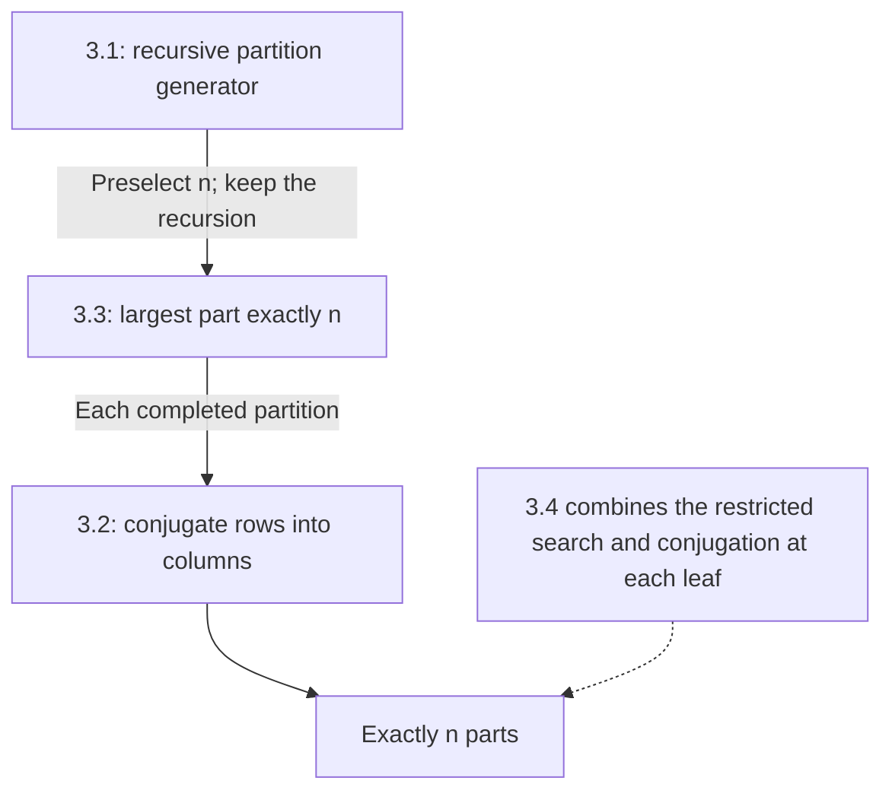

<blockquote>
<strong>Prefer slides?</strong> Open the interactive presentation in
<a href="{{ '/assets/presentations/integer-partitions/en.html' | relative_url }}">English</a>
or <a href="{{ '/assets/presentations/integer-partitions/fa.html' | relative_url }}" lang="fa" dir="rtl">فارسی</a>.
Both versions include reversible algorithm animations and a recursion-tree example.
Download the <a href="{{ '/assets/presentations/integer-partitions/en.pdf' | relative_url }}">English PDF</a>
or <a href="{{ '/assets/presentations/integer-partitions/fa.pdf' | relative_url }}">Persian PDF</a> for a static copy.
</blockquote>

<figure>
  
</figure>

These notes accompany my MSc combinatorial-algorithms presentation on integer partitions. The main sequence follows Algorithms 3.1–3.4 in Kreher and Stinson: start with one recursive generator, change its initialization to fix the largest part, then use conjugation to fix the number of parts. The counting recurrence and complexity derivations below are supplementary explanations.

## Partitions and Standard Form

A **partition** of a positive integer $m$ is a sum of positive integers, ignoring their order. Thus $4+2+1$ and $1+4+2$ represent the same partition of $7$. Repeated parts are allowed.

A partition is unordered; its **standard form** is a convention for writing it uniquely:

$$
m=a_1+a_2+\cdots+a_N,
\qquad a_1\ge a_2\ge\cdots\ge a_N\ge1.
$$

For example, $[1,3,2,1]$ becomes $[3,2,1,1]$. Sorting changes the written order, not the partition. Here $N$ is the number of parts; later, $n$ specifies a requested constraint.

Coin values provide a useful picture: a partition splits an amount into positive integer values. Unlike ordinary currency change, every positive integer denomination is available, and the goal is not to minimize the number of coins.

## Counting and Growth

$P(m)$ is the **number of partitions**, not a running time or a growth rate itself:

$$
P(1),P(2),P(3),P(4),P(5),P(6)=1,2,3,5,7,11.
$$

Exact computation is possible, even though no simple elementary closed-form expression is known. The Hardy–Ramanujan asymptotic formula describes how the count grows:

$$
P(m)\sim\frac{e^{\pi\sqrt{2m/3}}}{4m\sqrt3}.
$$

The symbol $\sim$ means the ratio tends to $1$ as $m$ grows. It is not exact equality for a fixed input. Equivalently at the level of growth order,

$$
P(m)=\Theta\!\left(\frac{e^{\pi\sqrt{2m/3}}}{m}\right).
$$

Counting gives a number such as $P(4)=5$. **Enumeration** produces the five partitions themselves.

## Algorithm 3.1 — Generate All Partitions

The goal is to output every partition of $m$ exactly once, already in standard form.

A call `Rec(r, B, N)` completes the selected prefix `a[1..N]`. The state has the following meaning:

| Symbol | Meaning |
| :--- | :--- |
| $m$ | Original target sum |
| $r$ | Sum still remaining |
| $B$ | Largest allowed next part |
| $N$ | Number of parts already selected |
| $a[1..N]$ | Selected prefix |
| $i$ | Candidate next part |

Try every positive $i\le\min(B,r)$. After selecting $i$, reduce the remainder and make $i$ the next bound. This prevents later parts from becoming larger.

```text
procedure Rec(r, B, N):
    if r == 0:
        output a[1..N]
        return
    for i = 1 to min(B, r):
        a[N+1] = i
        Rec(r-i, i, N+1)

Rec(m, m, 0)
```

The invariant is **selected-part sum + remainder = original target**. When $r=0$, the active prefix is a complete partition. Only `a[1..N]` is output; later array cells may contain values from an earlier branch.

For $m=4$, the ascending loop outputs

$$
[1,1,1,1],\quad[2,1,1],\quad[2,2],\quad[3,1],\quad[4].
$$

Each partition has one allowed path through the recursion tree, so there are no reordered duplicates.

## Ferrers–Young Diagrams and Algorithm 3.2

Draw a left-justified row of $a_i$ dots for each part. Reading **column heights** instead of row lengths gives the conjugate partition:

$$
a=[4,2,1]\quad\longleftrightarrow\quad b=[3,2,1,1].
$$

More precisely,

$$
b_j=\left|\{i:a_i\ge j\}\right|.
$$

Here $i$ is a row index, $j$ is a column index, and the vertical bars count how many rows reach column $j$.

Algorithm 3.2 initializes the first row's columns and counts the contribution of later rows:

```text
procedure ConjPartition(a[1..N]):
    for j = 1 to a[1]:
        b[j] = 1
    nPrime = a[1]
    for i = 2 to N:
        for j = 1 to a[i]:
            b[j] = b[j] + 1
    return b[1..nPrime]
```

Every positive row contributes one dot to the first column. Consequently, **the number of input parts becomes the largest conjugate part**, while the largest input part becomes the number of conjugate parts. Conjugating twice restores the original partition. This gives a bijection between partitions with exactly $n$ parts and partitions whose largest part is exactly $n$.

## Algorithm 3.3 — Fix the Largest Part

To generate partitions whose largest part is **exactly $n$**, preselect that part:

```text
a[1] = n
Rec(m-n, n, 1)
```

Why not just call `Rec(m,n,0)`? That only requires every part to be **at most** $n$. For example, `Rec(4,2,0)` also emits $[1,1,1,1]$, whose largest part is $1$.

Preselecting $n$ guarantees that it occurs; bounding all later parts by $n$ guarantees that nothing larger occurs. The recursion of 3.1 is unchanged. For positive totals, assume $1\le n\le m$.

## Algorithm 3.4 — Fix the Number of Parts

Suppose the target is all partitions of $7$ into **exactly three parts**. Generate the largest-part-three family with 3.3, then conjugate each output with 3.2:

| Intermediate partition: largest part 3 | Conjugate: exactly 3 parts |
| :--- | :--- |
| $[3,1,1,1,1]$ | $[5,1,1]$ |
| $[3,2,1,1]$ | $[4,2,1]$ |
| $[3,2,2]$ | $[3,3,1]$ |
| $[3,3,1]$ | $[3,2,2]$ |

Algorithm 3.4 integrates this conversion into the recursive leaf: when $r=0$, compute `ConjPartition(a[1..N])` and output that result instead of the intermediate prefix. Intermediate partitions need not all be stored.

## Exact Counting and the Empty Partition

Let $P(m,n)$ count partitions of $m$ into exactly $n$ positive parts. Separate them into two disjoint groups:

1. **A part equal to 1 occurs:** remove just one such part, leaving a partition counted by $P(m-1,n-1)$.
2. **Every part is at least 2:** subtract 1 from each part, leaving a partition counted by $P(m-n,n)$.

Each transformation has a unique inverse. For positive $m,n$,

$$
P(m,n)=P(m-1,n-1)+P(m-n,n).
$$

For a single consistent example, the three partitions of $6$ into three parts are $[4,1,1]$, $[3,2,1]$, and $[2,2,2]$. The first two belong to the first group, and the third belongs to the second:

$$
P(6,3)=P(5,2)+P(3,3)=2+1=3.
$$

The boundary value $P(0,0)=1$ counts **one empty partition**: the empty list, with no parts and sum zero. The 1 counts arrangements, not parts. Impossible cases have count zero, including negative arguments, $n>m$, $P(0,n)$ for positive $n$, and $P(m,0)$ for positive $m$.

$$
P(1,1)=P(0,0)+P(0,1)=1+0=1.
$$

For positive $m$, the groups by part count also give

$$
P(m)=\sum_{n=1}^{m}P(m,n).
$$

## Complexity and How the Algorithms Fit Together

In the recursion tree for $m=4$, there are **12 calls, five leaves, and maximum depth four**. Each leaf is one completed partition, and every partition occurs once; therefore the number of leaves is $P(m)$.

A path has at most $m$ choices because each choice subtracts a positive integer from the remainder. If $V$ counts tree nodes, every non-root node lies on at least one leaf path:

$$
V\le1+\sum_{\text{leaves}}\text{depth}\le1+mP(m).
$$

The search takes $O(V)$ work. Writing the outputs costs the sum of their lengths, also at most $mP(m)$. Thus

$$
T(m)=O(mP(m))=O\!\left(e^{\pi\sqrt{2m/3}}\right).
$$

This is an upper bound, not an exact operation count or a constant-delay claim. It is exponential in $\sqrt m$, hence subexponential in $m$.

| Algorithm | Task | Time bound | Reason |
| :--- | :--- | :--- | :--- |
| 3.1 | Generate all partitions | $O(mP(m))$ | At most $m$ choices per path and $P(m)$ output leaves |
| 3.2 | Conjugate one partition | $\Theta(m)$ | $a_1$ initializations plus $m-a_1$ increments |
| 3.3 | Fix largest part $n$ | $O(mP(m,n))$ | Same search, restricted to a family of size $P(m,n)$ by conjugation |
| 3.4 | Fix number of parts $n$ | $O(mP(m,n))$ | Restricted search plus one $\Theta(m)$ conjugation per output |

These bounds assume unit-cost arithmetic. With streamed outputs, the generators use $O(m)$ working space, including the active prefix, stack, and current output. Conjugating one partition uses $\Theta(a_1)$ additional output space, excluding its existing input.



The key idea is reuse: **change the initialization to restrict the family, then use a reversible transformation to obtain the requested constraint.**

## Reference

Donald L. Kreher and Douglas R. Stinson. *Combinatorial Algorithms: Generation, Enumeration, and Search*. CRC Press, 1999. Integer-partition definitions and Algorithms 3.1–3.4, printed pages 67–70. The presentation adds coin illustrations, worked counting examples, and explicit complexity explanations.
